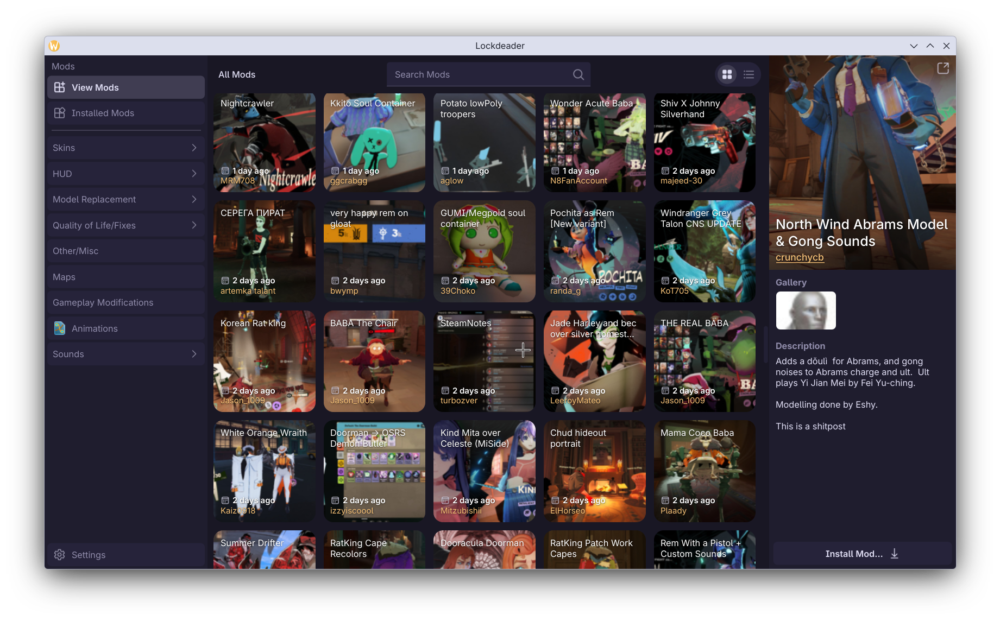

# Lockdeader - A Deadlock mod manager

Lockdeader is a mod manager for Deadlock which aims to make your modding experience just a bit nicer :)

It has a pretty nice (if I may say so myself) **native** Qt/QML based UI.

You should feel free to try it if you're the kind of person who wants to try something new, or alternatively 
if you're a Linux user and you're super tired of how *NICE* Tauri apps feel on Linux :)

---

# Responsible AI Disclosure

This project heavily uses AI for development, but I try to make sure it doesn't devolve into complete slop.

I'm the main designer of the UI and I make sure the UX seems good enough for me.

Only the code is AI generated, if there are any kinds of images or icon assets they're handmade by me.
